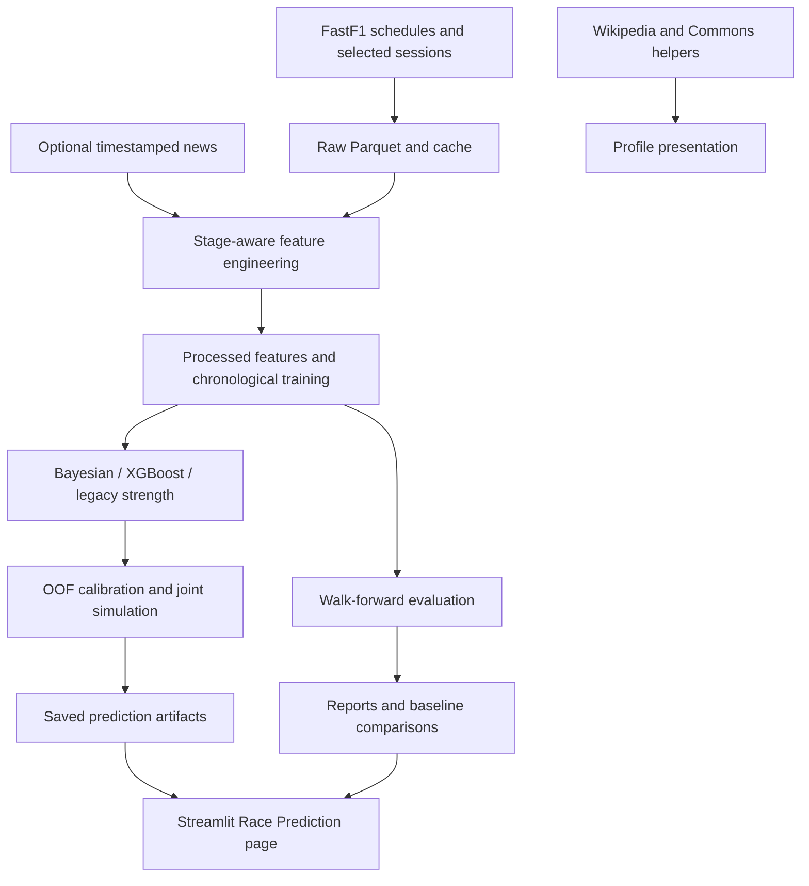

[](https://www.python.org/)
[](./LICENSE)
[](https://streamlit.io/)
[](./.github/workflows/tests.yml)

> **Probabilistic race forecasting pipeline, point-in-time feature engineering, Bayesian & XGBoost strength models, and interactive Streamlit analytics for Formula 1.**

## Overview

F1 Race Intelligence estimates driver win, podium, top-10, retirement, and
finishing-position probabilities for Grand Prix, sprint, and qualifying sessions.
It combines FastF1 data collection, point-in-time feature engineering, competitive
strength models, Monte Carlo simulation, and a Streamlit analytics application.

The CLI defaults to a Bayesian and XGBoost strength ensemble. Standalone Bayesian
and legacy models remain available for comparison. The initial case study is the
2026 Brazilian/São Paulo Grand Prix at Interlagos, but the workflow accepts other
scheduled events.

Forecasts are probabilistic, not guarantees. For completed events, reconstruct a
pre-session cutoff and reserve actual results for evaluation.

> [!IMPORTANT]
> The prediction pipeline and saved-run Race Prediction page are implemented.
> Other dashboard pages still contain illustrative or hard-coded content,
> including the home-page accuracy figures and Model Laboratory leaderboard.
> These are not measured model results. Use generated walk-forward reports to
> assess performance; no accuracy improvement is claimed for the ensemble.

## Contents

* [Quick start](#quick-start)
* [Prediction workflow and CLI](#prediction-workflow-and-cli)
* [Data collection](#data-collection)
* [Feature engineering and leakage prevention](#feature-engineering-and-leakage-prevention)
* [Models and simulation](#models-and-simulation)
* [Evaluation and uncertainty](#evaluation-and-uncertainty)
* [Streamlit dashboard](#streamlit-dashboard)
* [Next.js web app](#nextjs-web-app)
* [Architecture and repository layout](#architecture-and-repository-layout)
* [Generated artifacts](#generated-artifacts)
* [Tests](#tests)
* [Troubleshooting](#troubleshooting)
* [Roadmap](#roadmap)
* [Data sources and attribution](#data-sources-and-attribution)

## Quick start

### Prerequisites

* Python 3.11 or a compatible newer version; Python 3.12 is used in CI
* Network access for FastF1 schedules and session downloads
* A terminal opened at the repository root

Dependencies are listed in [requirements.txt](./requirements.txt). The current
stack uses pandas, NumPy, PyArrow/Parquet, scikit-learn, SciPy, XGBoost, Streamlit,
and Plotly. Dependencies are not pinned, so preserve your environment when
comparing or reproducing experiments.

### Install dependencies

The following commands use PowerShell on Windows:

```powershell
python -m pip install uv
python -m uv venv --python 3.12 .venv
python -m uv pip install --python .venv\Scripts\python.exe -r requirements.txt pytest
.\.venv\Scripts\Activate.ps1
$env:PYTHONUTF8 = "1"
```

Activate the environment again in each new terminal, or invoke
`.\.venv\Scripts\python.exe` directly. Configure your editor to use that
interpreter.

### Generate a forecast

The automatic command collects missing data, builds features, reuses a matching
model or trains one, and writes predictions:

```powershell
python main.py race 2026 "Brazilian Grand Prix"
```

The first run can take time because it downloads selected historical weekends
from 2021 through the target year. Existing saved sessions and the FastF1 cache
are reused. A completed target event is still forecast using earlier evidence;
it is never included in its own training data.

For explicit training and prediction:

```powershell
python main.py train race 2026 "Brazilian Grand Prix" --stage post_quali
python main.py predict race 2026 "Brazilian Grand Prix" --stage post_quali --skip-collection
```

Keep the stage, model variant, and training data consistent between commands.
`predict` does not silently train a missing or stale model.

### Open the dashboard

```powershell
python -m streamlit run app\app.py
```

Open the local URL printed by Streamlit and select Race Prediction in the
sidebar. The page discovers saved predictions; without them it displays a
labeled demo.

## Prediction workflow and CLI

Run all commands from the repository root:

```text
python main.py <session> <year> "<event>" [options]
python main.py train <session> <year> "<event>" [options]
python main.py predict <session> <year> "<event>" [options]
python main.py evaluate <session> <year> "<event>" [options]
```

Supported sessions are `race`, `sprint`, and `qualifying`. Target years must be
2021 or later. Event lookup is schedule-based and accepts names, locations, and
countries while ignoring case, accents, and trailing `Grand Prix`/`GP`.
`Brazilian Grand Prix` resolves to the scheduled São Paulo event where applicable.
Use the exact scheduled event name when a country or location is ambiguous.

### Actions

* Omit the action to reuse a matching model or train one before prediction.
* Use `train` to persist a versioned model without generating predictions.
* Use `predict` to load a matching model and generate a forecast without retraining.
* Use `evaluate` for chronological walk-forward reports, not a single-event forecast.

Every action prepares features and, unless `--skip-collection` is supplied,
attempts collection. Evaluation uses temporary model artifacts and does not
modify production models.

### Prediction stages

| Stage            | Eligible same-weekend evidence                                                          |
| ---------------- | --------------------------------------------------------------------------------------- |
| `pre_weekend`    | No same-weekend observations; cutoff is the earliest available weekend session start.   |
| `post_fp`        | Earlier practice observations before the weekend's first eligible non-practice start.   |
| `post_quali`     | Eligible earlier sessions before the target start, including qualifying where relevant. |

`post_quali` is the default stage name, not permission to use the target
session's classification. For qualifying forecasts, the target qualifying result
is still excluded. On sprint weekends, `post_fp` does not include practice
sessions occurring after the first non-practice cutoff.

> [!NOTE]
> Stage filtering does not supply an entry list. If the target has no saved
> results, the CLI needs a saved schedule and confirmed earlier qualifying,
> sprint-qualifying, or sprint entrants. Practice-only drivers are not accepted
> as confirmed entrants. A forecast before those records exist can fail even
> with `--stage pre_weekend`; an external verified-entry-list CLI is not implemented.

### Options

| Option                      | Default          | Purpose                                                                 |
| --------------------------- | ---------------- | ----------------------------------------------------------------------- |
| `--stage`                   | `post_quali`     | Select `pre_weekend`, `post_fp`, or `post_quali`.                       |
| `--strength-model`          | `ensemble`       | Select `ensemble`, `bayesian`, or `legacy`.                             |
| `--skip-collection`         | Off              | Build from saved raw data without collecting schedules or sessions.     |
| `--model-path`              | Auto-discovery   | Load a specific trusted model artifact for training/prediction actions. |
| `--n-simulations`           | `20000`          | Positive number of simulations per forecast or evaluation race.         |
| `--seed`                    | `42`             | Seed simulation and walk-forward evaluation.                            |
| `--scenario`                | `standard_dry`   | Select a forecast sensitivity scenario.                                 |
| `--events-per-season`       | `6`              | Positive collection budget per season, including the target event.      |
| `--similar-circuits`        | Built-in preset  | Override circuit names; pass no names to disable the preset.            |
| `--measure-variation`       | Off              | Backtest one completed target and save actual-versus-predicted errors.  |

`--model-path` must pass the current data/code fingerprint and stage/session
checks. Load only model artifacts you trust. Evaluation controls its own
chronological refits; it does not use this path or the forecast `--scenario`.

Inspect the command help with:

```powershell
python main.py --help
python -m src.data.collect_season --help
```

### Session and scenario examples

```powershell
python main.py sprint 2026 "Brazilian Grand Prix"
python main.py qualifying 2026 "Brazilian Grand Prix"
python main.py predict race 2026 "Brazilian Grand Prix" --skip-collection --scenario wet_chaos
```

Available scenarios are `standard_dry`, `wet_chaos`, `high_safety_car`,
`high_degradation`, and `reliability_attrition`.

Non-reference scenarios are heuristic sensitivity analyses. Their rain,
safety-car, and degradation effects are not learned driver-specific responses
and are not separately calibrated.

## Data collection

### Bounded collection used by the prediction CLI

The CLI collects at most six related weekends per season from 2021 through the
target year. It fetches full schedules for selection, not every session in the
calendar. Weekend selection prioritizes:

1. The target event, matched by event name or normalized circuit.
2. Its two preceding calendar events.
3. Up to two additional events from the similarity preset.
4. Additional preceding events, then remaining similar events, up to the budget.

Selected events are deduplicated. In the target season, rounds after the target
are excluded. Older seasons may include similar circuits later in their
calendars, but chronological features exclude them from earlier forecasts.

Presets in [event_selection.py](./src/data/event_selection.py) are editable
collection heuristics, not learned similarity scores. The Interlagos family
includes Austin, Spielberg, Barcelona, Silverstone, and Suzuka. Unknown circuits
produce a warning and use the target plus preceding events.

```powershell
python main.py race 2026 "Brazilian Grand Prix" --events-per-season 6
python main.py race 2026 "Brazilian Grand Prix" --similar-circuits Austin Silverstone
python main.py race 2026 "Brazilian Grand Prix" --events-per-season 4 --similar-circuits
```

The collector logs its selection, skips already saved sessions, and attempts
missing elapsed sessions. Missing required selected data produces an error.
Previously collected events are not deleted and can still supply evidence, so
the download budget is not a strict training-set filter.

> [!IMPORTANT]
> A smaller download budget means less evidence. Form and season points describe
> collected sessions, not necessarily complete championship standings.
> Points-per-start and history-count features expose coverage but cannot restore
> missing results. Related-circuit backtests do not establish calendar-wide accuracy.

### Optional full-season or manual collection

The standalone collector has broader defaults than the prediction CLI: seasons
2018 through 2026, excluding 2020. An explicit inclusive range includes 2020.

```powershell
python -m src.data.collect_season
python -m src.data.collect_season --start-year 2021 --end-year 2026
python -m src.data.collect_season --start-year 2021 --end-year 2026 --event "Brazilian Grand Prix"
python -m src.data.collect_season --year 2019 --year 2021 --year 2024
```

Do not combine `--year` with a range. Supply both range endpoints, with the
start no later than the end. Manual collection can retain pre-2021 data, but
the prediction CLI restricts its feature inputs to 2021 through the target year.

Practice, qualifying, sprint qualifying, sprint, and race data are written as
year/session Parquet files containing results, laps, weather, and race-control
messages, plus yearly schedules. Rows retain event/session identifiers and
scheduled UTC start times when available. Future or failed sessions do not
overwrite previously saved session data.

Collection refreshes the driver and constructor CSV inventories from all saved
results, not only the latest request. These are identity lists, not complete
career-statistics databases. See the [data pipeline reference](./src/data/README.md)
for lower-level collection details.

## Feature engineering and leakage prevention

The CLI builds stage-specific feature tables and reuses them only when their
raw-file metadata/code fingerprint matches. Raw inputs use path, size, and
nanosecond modification time; Python sources retain content hashes. Replacing
raw data must update its size or modification time to invalidate the cache.
The CLI also refreshes the canonical
session feature filename for existing analysis pages.

For a standalone rebuild using the feature module's default `post_quali` stage:

```powershell
python -m src.features.engineer_features
```

This writes race, sprint, qualifying, and sprint-qualifying feature tables when
those target sessions exist. Sprint qualifying has a feature table but is not
a supported prediction CLI session.

Feature groups include driver and constructor history, circuit form, regulation
era, qualifying/grid evidence, practice pace, tyres, earlier weekend weather,
race-control summaries, retirement history, and optional timestamped news.

Point-in-time rules apply throughout:

* Historical source sessions must start strictly before the feature cutoff.
* Same-weekend evidence must also satisfy the selected stage.
* Target classifications remain in `target_*` columns and never become model inputs.
* Training events precede the target's feature cutoff; the target is held out.
* Timestamped observations, grid publication, and news respect the cutoff.
* Missing evidence is represented through missingness handling, not invented measurements.

For `post_quali` race and sprint forecasts, an eligible earlier qualifying grid
or an official grid with `GridPublishedAt` before the cutoff takes precedence.
Otherwise qualifying order supplies `grid_position` with `grid_is_quali_proxy=1`.
Proxy grids do not imply known penalties or pit-lane starts. Official pit-lane
starts use field size plus one as a back-of-grid position and retain
`pit_lane_start=1`. Historical race grids without publication evidence are not
silently treated as known before the cutoff.

Qualifying gaps compare the same Q1, Q2, or Q3 phase. Practice pace excludes
deleted, inaccurate, flagged, and pit laps when flags exist. Long-run residuals
compare multiple drivers within the same session, compound, tyre age, and
ten-minute track-time cohort when timestamps are available. Counts, dispersion,
and timestamp coverage expose weak comparisons; unobserved fuel loads remain
a limitation.

Legacy files use saved schedule timestamps where available. A deterministic
year/round/session fallback cannot recover the actual time of day. Circuit
identity uses FastF1 location or event name; naming changes may need curated
aliases.

### Feature and retirement audit

After refreshing data, audit the staged race table and raw status distribution:

```powershell
python -m scripts.audit_features
python -m scripts.audit_features --features data\processed\race_features.parquet
```

The audit saves [reports/feature_audit.json](./reports/feature_audit.json) and
prints feature coverage, race counts by year, distinct grid positions per race,
latest-driver inputs (including teammate gaps and newcomer flags), and known
versus unknown retirement labels. Missingness flags are respected when counting
neutral-imputed values. It exits with code 1 on missing columns, degenerate
post-qualifying grids in fields of at least 18 drivers, inconsistent proxies,
or unavailable raw status data. Use `--raw-dir` and `--output` to select inputs
and report location.

### Optional news

Supply a local CSV with a `PublishedAt`, `published_at`, or `PublishedUTC`
timestamp and an `EventName`, `CircuitName`, or `Year` to identify its scope.
The CLI reads `data\raw\news.csv` and news Parquet inputs. Only reports published
before the feature cutoff contribute. The pipeline does not fetch, infer, or
backdate news.

## Models and simulation

### Model variants

CLI commands default to `--strength-model ensemble`. Python APIs retain the
legacy default for compatibility; pass a variant explicitly when comparing APIs
with CLI output.

* `ensemble` blends dynamic Bayesian strength with the conditional-finisher
  XGBoost ranker, not a second winner classifier.
* `bayesian` uses a dynamic driver/constructor Plackett-Luce strength model.
* `legacy` retains the XGBoost/logistic competitive-strength model.

Competitive ranking is trained on non-retired drivers to avoid penalizing a
retirement in both ranking and simulation. Legacy ranking/logistic components
use a 30-event recency half-life and one-quarter weight for earlier regulation
eras. Form is era-specific; sprint/Grand Prix histories and qualifying formats
remain separate.

### Ensemble fitting

For normalized strengths `b` and `x`, combined strength is
`w * b + (1 - w) * x`. Training-race centered root-mean-square scores determine
each component's scale. Each past-only out-of-fold (OOF) split fits its own scales
using training data only; the held-out field is centered but never estimates
those scales. Constant training scores use unit normalization with a warning.

A bounded weight search includes both pure-component endpoints. It minimizes
OOF final win and podium log loss at unit temperature using 512 simulations per
race and repeatable seeds. A single final temperature is fitted on the blended
OOF distribution using 1,024 simulations per race. Outer walk-forward test races
do not participate in scaling, weight selection, or calibration.

Bayesian covariance is divided by its training scale squared and multiplied by
`w` squared, preserving driver/constructor correlations. XGBoost is a point
estimate. Without OOF races, the prior weight is 0.5 and temperature is 1.0,
explicitly recorded in provenance. Small calibration samples generate warnings.
Artifacts identify `race_bayesian_xgb_v1` and retain component order, scales,
weights, and fitting provenance.

### Dynamic Bayesian challenger

Driver and constructor effects use zero-sum contrasts, Gaussian shrinkage
priors, and random-walk evolution. Standardized pre-event grid, form, qualifying,
and practice features supply regularized context effects. Each chronological
race produces a Laplace Gaussian update: approximate inference, not MCMC or a
causal separation of driver skill from car performance.

Prior standard deviations are 0.5 for drivers/context coefficients and 1.0 for
constructors. Per-14-day process standard deviations are 0.035 for drivers and
0.10 for constructors. Crossing a 2022 or 2026 regulation boundary retains
one-quarter of constructor means and restores constructor prior variance.
These are fixed experimental assumptions, not empirically optimized parameters.

Unseen entities receive zero-mean prior effects; teammates share constructor
uncertainty. Predictions must be strictly after the last training race.
Each simulation samples correlated latent strength and race outcomes, including
the same covariance and retirement process used for OOF calibration.

Metadata identifies `race_bayesian_laplace_v1` and
`laplace_strength_and_outcome_uncertainty`. Retirement parameters, prior scales,
model selection, and calibration uncertainty are not integrated out.
NumPy/SciPy supply the inference without additional dependencies.

### Joint outcome simulation

One permutation distribution supplies position probabilities, win/podium/top-10
probabilities, and expected positions. For a field of `N` drivers:

* Win probabilities sum to 1.
* Podium probabilities sum to `min(3, N)`.
* Top-10 probabilities sum to `min(10, N)`.
* Each driver's probabilities satisfy `win <= podium <= top10`.
* The full position-probability matrix has row and column sums of 1.

A half-simulation uniform-order prior within sampled finisher/retiree groups
reduces rare-order zeros while preserving those constraints and impossible
outcomes.

Retirement probabilities are shrunk by entity and recency. Mechanical,
collision, and unidentified terminal causes are exclusive components; unknown
causes are not invented. A shrunk Gaussian-copula race effect allows common
retirement shocks while preserving marginal risks. This moment estimate is
approximate, not a fully fitted accident or team-reliability model.
`Finished`, `Lapped`, and `+N Lap(s)` statuses count as finishes.
Disqualifications, exclusions, withdrawals, and non-starts remain unknown,
not retirements.

One temperature calibrates final win/podium probabilities from expanding,
past-only OOF forecasts, including retirement and the reference scenario.
Baselines use the same calibration races and simulator. Qualifying predictions
disable race retirement and safety-car processes.

Saved latent strengths, retirement risks, dependence, temperature, covariance,
driver order, seed, and simulation count support seeded replay after Parquet
round trips or row shuffles. Final probabilities are not reused as latent scores.

Remaining simplifications include Plackett-Luce relative odds, a constant-hazard
retirement-distance proxy, finishers preceding retirees, and no lap-level fuel,
pit-strategy, or lapped-car classification model.

## Evaluation and uncertainty

### Walk-forward evaluation

```powershell
python main.py evaluate race 2026 "Brazilian Grand Prix" --stage post_quali
python main.py evaluate race 2026 "Brazilian Grand Prix" --strength-model bayesian --skip-collection
python main.py evaluate race 2026 "Brazilian Grand Prix" --strength-model legacy --skip-collection
```

Compare variants with identical saved data, stages, seeds, and simulation
counts. Evaluation considers completed events through the requested target,
begins after eight training events, and refits every four events. It needs at
least nine completed events to produce a report. Partially observed fields are
rejected. Fewer than ten held-out or calibration races generate warnings.

Reports include:

* Winner, podium, top-10, and DNF Brier scores
* DNF Brier skill against a constant rate estimated from that fold's training labels
* Winner/podium log loss, marginal finishing-position log loss, and ranked probability score
* Rank correlations, position errors, and P10-P90 outcome-range coverage
* Baseline comparisons, reliability tables, and driver/team signed-error reports
* Race-block bootstrap intervals and paired differences against the grid baseline

`finisher_pl_nll_diagnostic` is a conditional, no-scenario diagnostic, not the
likelihood of the full simulation mixture or a headline comparison score.
Overall signed position bias is omitted because it is zero by construction for
a complete field.

Confidence reports use 500 circular race-block bootstrap samples with block
length `ceil(number_of_races ** (1/3))`. Intervals are omitted with fewer than
five held-out races. They describe the sampled backtest, not a guarantee of
improvement or a remedy for selective circuit coverage.

The grid baseline skips constant or missing candidate columns, and the separate
`quali` baseline uses only `quali_position`. An unavailable starting-order feature
produces uniform strengths with a warning, not a claimed informative benchmark.
`dnf_constant_brier` measures the training-rate prediction's squared error on
the same held-out labels as the model. `dnf_brier_skill = 1 - dnf_brier /
dnf_constant_brier`; positive values indicate improvement. Skill is unavailable
when training labels are unknown or reference error is zero.
Summary and bootstrap skill scores use the ratio of race-averaged losses,
not the average of individual race skill scores.

### Single completed-event variation

```powershell
python main.py race 2024 "São Paulo Grand Prix" --measure-variation
```

This is a backtest, not a live pre-event forecast. It trains only on earlier
events, uses temporary artifacts without modifying production models, and
persists actual-versus-predicted errors. It requires complete winner, podium,
and position labels plus sufficient earlier training history.

### Interpreting uncertainty

Legacy P10-P90 position ranges describe conditional simulated outcomes. Bayesian
ranges also integrate approximate latent-strength uncertainty. Neither is a
credible interval for individual model parameters. `win_probability_mcse`
describes approximate numerical Monte Carlo error only.

More simulations reduce sampling noise, not model misspecification. Check
calibration and baseline comparisons on later, untouched races before trusting
forecasts.

## Streamlit dashboard

The Race Prediction page discovers saved runs and defaults to the newest file.
It displays event/stage/model provenance, win/podium/top-10 forecasts, DNF risk,
position distributions, grid disagreement, linked variation metrics, and
available evaluation reports. Current artifacts support saved simulation replay
and scenario analysis. Legacy/demo artifacts remain viewable, but replay is
disabled when the required latent-input fields are absent.

Additional pages cover weekend analytics, telemetry, drivers, constructors,
circuits, and a model laboratory. These are a mixture of implemented utilities
and prototype presentation. Do not interpret hard-coded charts, telemetry,
leaderboards, or headline metrics as live data or validated results.

Wikipedia/Wikimedia enrichment helpers support contextual profiles and media.
Keep presentation enrichment separate from prediction evidence, and verify
media licensing before reuse.

## Next.js web app

[web/](./web/) is **Gridcast**, a Next.js (App Router) and Tailwind CSS front end styled after
the F1 TV look: dark track palette, red accents, italic display headings, and
card rails. It is an unofficial fan interface and uses no official logos, fonts,
or images. It shows only values from saved model output, so it omits the
hard-coded driver statistics, weather, and leaderboards of the Streamlit
prototype. Pages cover home, predictions (sortable table, finishing-position
heatmap, scenarios), drivers, teams, circuit, model lab, and method.

The app reads JSON exported from saved artifacts. Python writes it; Node never
touches Parquet:

```powershell
python main.py race 2026 "Brazilian Grand Prix"
python -m scripts.export_web_data --demo
cd web
npm install
npm run dev
```

Open <http://localhost:3000>. Headings use Noto Sans. If you hold a licence for
Formula1 Display, place `Formula1-Display-Bold.woff2` (or `.otf`) in
`web/public/fonts/` and the headings use it automatically; the folder is
git-ignored, so the font is never committed. The export writes one JSON file per saved
prediction in `web/public/data/runs/`, replays every scenario through the
production simulator, attaches matching walk-forward reports, and writes a
manifest. Use `--output`, `--predictions-dir`, and `--reports-dir` to change
locations. `--demo` appends an *illustrative sample* built from invented driver
strengths; every page labels it, and it is never a forecast. Without `--demo`
and without saved runs, the export exits with code 1 and the app shows an empty
state. Select a saved run with the `?run=<id>` query parameter or the run picker.

The Model Lab page contains the measured pre-fix walk-forward scoreboard as a
fixed reference. Re-run `evaluate` and re-export to display current reports.
Run `npm run build` and `npm run typecheck` before publishing changes.

## Architecture and repository layout



| Path                                                          | Responsibility                                        |
| ------------------------------------------------------------- | ----------------------------------------------------- |
| [main.py](./main.py)                                          | Collection, staged features, train/predict/evaluate   |
| [src/data](./src/data/)                                       | Collection, event selection, entities, validation     |
| [src/features](./src/features/)                               | Point-in-time feature tables                          |
| [src/models](./src/models/)                                   | Strength models, calibration, baselines, evaluation   |
| [src/simulation](./src/simulation/)                           | Joint outcomes and sensitivity scenarios              |
| [src/enrichment](./src/enrichment/)                           | Wikipedia, Commons, and media metadata helpers        |
| [src/visualization](./src/visualization/)                     | Circuit and telemetry visualization helpers           |
| [src/utils/config.py](./src/utils/config.py)                  | Runtime paths, feature exclusions, shared constants   |
| [app](./app/)                                                 | Streamlit entry point and analytics pages             |
| [web](./web/)                                                 | Next.js and Tailwind CSS front end                    |
| [scripts](./scripts/)                                         | Feature audit and web data export                     |
| [tests](./tests/)                                             | Unit and integration coverage                         |
| [.github/workflows/tests.yml](./.github/workflows/tests.yml)  | Python 3.12 CI using unittest discovery               |

## Generated artifacts

Paths are relative to the repository root:

```text
data\
  cache\                 FastF1 cache
  raw\                   Year/session results, laps, weather, messages, schedules
  processed\             Feature tables, fingerprints, driver/constructor inventories
  predictions\           Forecasts, variation summaries, saved dashboard simulations
models\
  <run_id>\              Model artifact, training snapshot, metadata.json
reports\                 Walk-forward metrics, predictions, reliability, confidence
```

Generated models are ignored by Git; obsolete standalone model binaries are
not distributed. The tested standalone training modules and baseline classes
remain legacy comparison APIs, not the production CLI path.

Staged feature files use `<session>_<stage>_features.parquet` and a `.sha256`
sidecar; canonical `<session>_features.parquet` copies support existing analysis
pages. Model metadata records the variant, training hash, stage/session, feature
columns, Git SHA, training range, race count, and row count.

Prediction and variation filenames follow:

```text
predictions_<session>_<year>_rnd<round>[_<variant>]_<stage>.parquet
predictions_<session>_<year>_rnd<round>[_<variant>].parquet
variation_<session>_<year>_rnd<round>[_<variant>]_<stage>.parquet
variation_<session>_<year>_rnd<round>[_<variant>].parquet
```

The optional variant suffix is `_bayesian` or `_ensemble`; legacy filenames
have no variant suffix. Stage-less copies are refreshed with the latest forecast
for that session/event/variant, so they are not an immutable run archive.
Variation files exist only after `--measure-variation`.

Walk-forward outputs use
`walk_forward_<session>_<year>_rnd<round>_<stage>[_<variant>]_<report>.parquet`.
Reports include metrics, summary, reliability, predictions, bias, baselines,
and confidence tables.

Prediction rows contain `prob_p*` finishing distributions, win/podium/top-10/DNF
probabilities, expected/median/P10/P90 positions, model and training provenance,
stage, generation timestamp, scenario, simulation count, and seed.
`p10_finish` and `p90_finish` are empirical position quantiles conditional on
that driver not retiring, not ranks among finishers. They remain missing if no
simulation has the driver finish. These intervals use unsmoothed simulation
samples; the unconditional position distribution retains its existing smoothing.
The terminal prints decimal probabilities and separates forecasts from held-out errors.

Old model artifacts fail the current data/code fingerprint check and must be
retrained. Preserve raw inputs, artifacts, configuration, and the dependency
environment when reproducing a result.

## Tests

Run from the repository root with the installed development dependencies:

```powershell
$env:PYTHONUTF8 = "1"
python -m pytest -q
```

Collection is mocked in the offline test suite. Tests cover chronology, entity
handling, validation, orchestration, calibration, model variants, simulation
consistency, evaluation, and saved-run dashboard behavior.

CI currently runs the unittest-compatible suite:

```powershell
python -m unittest discover -s tests
```

UTF-8 mode avoids Windows locale-dependent decoding of Unicode UI sources.

## Troubleshooting

| Symptom                                | Action                                                                                                        |
| -------------------------------------- | ------------------------------------------------------------------------------------------------------------- |
| Target year is rejected                | Use 2021 or later for the prediction CLI.                                                                     |
| No saved schedule or unknown event     | Retry collection with network access; use the exact event name from the target season's schedule.             |
| No requested session or entrants       | Check session availability and saved qualifying/sprint entrants. The pipeline will not invent a field.        |
| Collection is slow or incomplete       | Allow the initial download to finish, inspect logged failures, and retry. Saved sessions are reused.          |
| Offline run lacks required inputs      | Collect schedules and sessions first; `--skip-collection` cannot supply missing data.                         |
| `fastf1` or Parquet import fails       | Activate the correct environment and install [requirements.txt](./requirements.txt), including PyArrow.       |
| No matching model or fingerprint error | Retrain with the same stage, variant, and current chronological inputs before running `predict`.              |
| Too little usable history              | Collect more real completed events before the cutoff, increase the budget, or use manual seasonal collection. |
| Evaluation needs nine events           | Supply at least eight completed training events plus one later completed test event.                          |
| Variation rejects missing outcomes     | Select a completed event with a complete classification and enough earlier training data.                     |
| Demo forecast or replay disabled       | Generate a current forecast, then select that saved run on the Race Prediction page.                          |

If manual collection reports failures, retry those sessions and run feature
engineering separately when you intend to use the successfully collected data.
Do not fabricate missing weather, telemetry, outcomes, or publication times.

## Roadmap

The longer-term goal is an explainable, reusable race-intelligence platform,
not a model fitted only to Brazilian Grand Prix results. Future work includes:

* Replacing prototype dashboard data with timestamped, source-backed artifacts
* Expanding calendar coverage and validating curated circuit/team identity mappings
* Comparing model variants on untouched later races before claiming improvement
* Evaluating richer strategy and lap-level simulation against the current baselines
* Adding experiment tracking and reproducible dependency/data snapshots
* Investigating tabular neural networks, sequential histories, and multimodal
  features only when they outperform simpler models under chronological validation
* Considering MLflow, Optuna, and optional Databricks workflows when experiment
  volume or data scale warrants them

These are research and engineering directions, not installed dependencies or
implemented deployment workflows.

## Data sources and attribution

* [FastF1 documentation](https://docs.fastf1.dev/) for session data and coverage
* [FIA](https://www.fia.com/) and [Formula 1](https://www.formula1.com/) for authoritative sporting information
* [scikit-learn](https://scikit-learn.org/stable/), [XGBoost](https://xgboost.readthedocs.io/),
  and [SciPy](https://docs.scipy.org/doc/scipy/) for the modelling stack
* [Streamlit](https://docs.streamlit.io/) and [Plotly](https://plotly.com/python/) for analytics presentation
* [MediaWiki APIs](https://www.mediawiki.org/wiki/API:REST_API) and
  [Wikimedia Commons reuse guidance](https://commons.wikimedia.org/wiki/Commons:Reusing_content_outside_Wikimedia)
  for contextual enrichment

Wikipedia is presentation context, not authoritative prediction evidence.
Retain source URLs, creator, license, attribution, and retrieval time for media.
Do not assume an image is reusable because it appears on Wikipedia or because
a metadata default names a license; verify the source file's actual terms.
