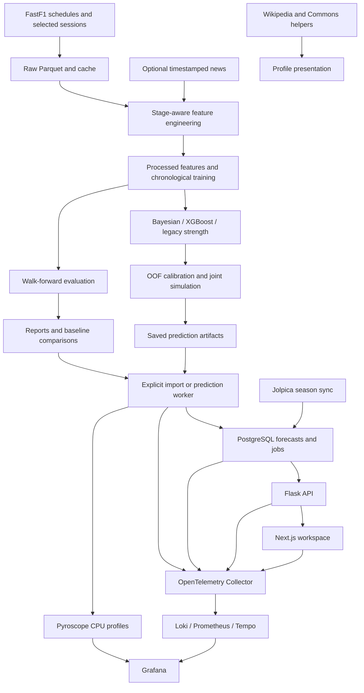

[](https://www.python.org/)
[](../LICENSE)
[](https://flask.palletsprojects.com/)
[](../.github/workflows/tests.yml)

> **Probabilistic race forecasting, point-in-time features, Bayesian & XGBoost models, and a Next.js / Flask / PostgreSQL workspace for Formula 1.**

Return to the [project overview and navigation](../README.md).
Run all commands from the repository root, not from this documentation folder.

## Overview

F1 Race Intelligence estimates driver win, podium, top-10, retirement, and
finishing-position probabilities for Grand Prix, sprint, and qualifying sessions.
It combines FastF1 data collection, point-in-time feature engineering, competitive
strength models, Monte Carlo simulation, and a Next.js application backed by
a containerized Flask API, prediction worker, and PostgreSQL database.

The CLI defaults to a Bayesian and XGBoost strength ensemble. Standalone Bayesian
and legacy models remain available for comparison. The initial case study is the
2026 Brazilian/São Paulo Grand Prix at Interlagos, but the workflow accepts other
scheduled events.

Forecasts are probabilistic, not guarantees. For completed events, reconstruct a
pre-session cutoff and reserve actual results for evaluation.

> [!IMPORTANT]
> This is a private, single-user installation, not an authenticated public service.
> Compose publishes Next.js, Grafana and telemetry ingestion on localhost;
> Flask and PostgreSQL stay internal. Grafana has local anonymous admin access.
> Do not expose it publicly without adding authentication and access controls.
> Use generated walk-forward reports to assess performance; no accuracy improvement
> is claimed for the ensemble.

## Contents

* [Quick start](#quick-start)
* [Prediction workflow and CLI](#prediction-workflow-and-cli)
* [Data collection](#data-collection)
* [Feature engineering and leakage prevention](#feature-engineering-and-leakage-prevention)
* [Models and simulation](#models-and-simulation)
* [Evaluation and uncertainty](#evaluation-and-uncertainty)
* [Flask API and PostgreSQL](#flask-api-and-postgresql)
* [Next.js web app](#nextjs-web-app)
* [Observability](#observability)
* [Architecture and repository layout](#architecture-and-repository-layout)
* [Generated artifacts](#generated-artifacts)
* [Tests](#tests)
* [Troubleshooting](#troubleshooting)
* [Roadmap](#roadmap)
* [Data sources and attribution](#data-sources-and-attribution)

## Quick start

### Prerequisites

* Python 3.11 or a compatible newer version; Python 3.12 is used in CI
* Network access for FastF1 schedules and session downloads
* A terminal opened at the repository root

Dependencies are listed in [requirements.txt](../requirements.txt). The current
stack uses pandas, NumPy, PyArrow/Parquet, scikit-learn, SciPy, XGBoost, Flask,
SQLAlchemy, and psycopg. Dependencies are not pinned, so preserve your environment when
comparing or reproducing experiments.

### Install dependencies

The following commands use PowerShell on Windows:

```powershell
python -m pip install uv
python -m uv venv --python 3.12 .venv
python -m uv pip install --python .venv\Scripts\python.exe -r requirements.txt pytest
.\.venv\Scripts\Activate.ps1
$env:PYTHONUTF8 = "1"
```

Activate the environment again in each new terminal, or invoke
`.\.venv\Scripts\python.exe` directly. Configure your editor to use that
interpreter.

### Generate a forecast

The automatic command collects missing data, builds features, reuses a matching
model or trains one, and writes predictions:

```powershell
python main.py race 2026 "Brazilian Grand Prix"
```

The first run can take time because it downloads selected historical weekends
from 2021 through the target year. Existing saved sessions and the FastF1 cache
are reused. A completed target event is still forecast using earlier evidence;
it is never included in its own training data.

For explicit training and prediction:

```powershell
python main.py train race 2026 "Brazilian Grand Prix" --stage post_quali
python main.py predict race 2026 "Brazilian Grand Prix" --stage post_quali --skip-collection
```

Keep the stage, model variant, and training data consistent between commands.
`predict` does not silently train a missing or stale model.

### Run the containerized app

Install Docker with Compose, then copy the example environment file and set
`POSTGRES_PASSWORD` to a long, random URL-safe value. Do not commit credentials.

```powershell
Copy-Item .env.example .env
# Set POSTGRES_PASSWORD in .env before starting.
docker compose up --build -d
docker compose exec api flask --app backend.app:create_app import-data
```

Open <http://localhost:3000>. Home is an app overview without forecast data.
Use Settings to choose prediction defaults, Predictions to submit and inspect
jobs, and Seasons to sync current or historical championship data.
Import is explicit and idempotent; no illustrative data is seeded at startup.
The existing CLI remains available independently.

Open <http://localhost:3001/d/gridcast-overview> for the provisioned Grafana
application and ML dashboard. The local LGTM stack starts with the app.

If direct PyPI downloads fail during the image build, set `PIP_INDEX_URL` in
your local environment file to an approved public package mirror. This is a
build-time option, not a browser setting; never put registry tokens in it.
Keep TLS verification enabled.

## Prediction workflow and CLI

Run all commands from the repository root:

```text
python main.py <session> <year> "<event>" [options]
python main.py train <session> <year> "<event>" [options]
python main.py predict <session> <year> "<event>" [options]
python main.py evaluate <session> <year> "<event>" [options]
```

Supported sessions are `race`, `sprint`, and `qualifying`. Target years must be
2021 or later. Event lookup is schedule-based and accepts names, locations, and
countries while ignoring case, accents, and trailing `Grand Prix`/`GP`.
`Brazilian Grand Prix` resolves to the scheduled São Paulo event where applicable.
Use the exact scheduled event name when a country or location is ambiguous.

### Actions

* Omit the action to reuse a matching model or train one before prediction.
* Use `train` to persist a versioned model without generating predictions.
* Use `predict` to load a matching model and generate a forecast without retraining.
* Use `evaluate` for chronological walk-forward reports, not a single-event forecast.

Every action prepares features and, unless `--skip-collection` is supplied,
attempts collection. Evaluation uses temporary model artifacts and does not
modify production models.

### Prediction stages

| Stage            | Eligible same-weekend evidence                                                          |
| ---------------- | --------------------------------------------------------------------------------------- |
| `pre_weekend`    | No same-weekend observations; cutoff is the earliest available weekend session start.   |
| `post_fp`        | Earlier practice observations before the weekend's first eligible non-practice start.   |
| `post_quali`     | Eligible earlier sessions before the target start, including qualifying where relevant. |

`post_quali` is the default stage name, not permission to use the target
session's classification. For qualifying forecasts, the target qualifying result
is still excluded. On sprint weekends, `post_fp` does not include practice
sessions occurring after the first non-practice cutoff.

> [!NOTE]
> Stage filtering does not supply an entry list. If the target has no saved
> results, the CLI needs a saved schedule and confirmed earlier qualifying,
> sprint-qualifying, or sprint entrants. Practice-only drivers are not accepted
> as confirmed entrants. A forecast before those records exist can fail even
> with `--stage pre_weekend`; an external verified-entry-list CLI is not implemented.

### Options

| Option                      | Default          | Purpose                                                                 |
| --------------------------- | ---------------- | ----------------------------------------------------------------------- |
| `--stage`                   | `post_quali`     | Select `pre_weekend`, `post_fp`, or `post_quali`.                       |
| `--strength-model`          | `ensemble`       | Select `ensemble`, `bayesian`, or `legacy`.                             |
| `--skip-collection`         | Off              | Build from saved raw data without collecting schedules or sessions.     |
| `--model-path`              | Auto-discovery   | Load a specific trusted model artifact for training/prediction actions. |
| `--n-simulations`           | `20000`          | Positive number of simulations per forecast or evaluation race.         |
| `--seed`                    | `42`             | Seed simulation and walk-forward evaluation.                            |
| `--scenario`                | `standard_dry`   | Select a forecast sensitivity scenario.                                 |
| `--events-per-season`       | `6`              | Positive collection budget per season, including the target event.      |
| `--similar-circuits`        | Built-in preset  | Override circuit names; pass no names to disable the preset.            |
| `--measure-variation`       | Off              | Backtest one completed target and save actual-versus-predicted errors.  |

`--model-path` must pass the current data/code fingerprint and stage/session
checks. Load only model artifacts you trust. Evaluation controls its own
chronological refits; it does not use this path or the forecast `--scenario`.

Inspect the command help with:

```powershell
python main.py --help
python -m src.data.collect_season --help
```

### Session and scenario examples

```powershell
python main.py sprint 2026 "Brazilian Grand Prix"
python main.py qualifying 2026 "Brazilian Grand Prix"
python main.py predict race 2026 "Brazilian Grand Prix" --skip-collection --scenario wet_chaos
```

Available scenarios are `standard_dry`, `wet_chaos`, `high_safety_car`,
`high_degradation`, and `reliability_attrition`.

Non-reference scenarios are heuristic sensitivity analyses. Their rain,
safety-car, and degradation effects are not learned driver-specific responses
and are not separately calibrated.

## Data collection

### Bounded collection used by the prediction CLI

The CLI collects at most six related weekends per season from 2021 through the
target year. It fetches full schedules for selection, not every session in the
calendar. Weekend selection prioritizes:

1. The target event, matched by event name or normalized circuit.
2. Its two preceding calendar events.
3. Up to two additional events from the similarity preset.
4. Additional preceding events, then remaining similar events, up to the budget.

Selected events are deduplicated. In the target season, rounds after the target
are excluded. Older seasons may include similar circuits later in their
calendars, but chronological features exclude them from earlier forecasts.

Presets in [event_selection.py](../src/data/event_selection.py) are editable
collection heuristics, not learned similarity scores. The Interlagos family
includes Austin, Spielberg, Barcelona, Silverstone, and Suzuka. Unknown circuits
produce a warning and use the target plus preceding events.

```powershell
python main.py race 2026 "Brazilian Grand Prix" --events-per-season 6
python main.py race 2026 "Brazilian Grand Prix" --similar-circuits Austin Silverstone
python main.py race 2026 "Brazilian Grand Prix" --events-per-season 4 --similar-circuits
```

The collector logs its selection, skips already saved sessions, and attempts
missing elapsed sessions. Missing required selected data produces an error.
Previously collected events are not deleted and can still supply evidence, so
the download budget is not a strict training-set filter.

> [!IMPORTANT]
> A smaller download budget means less evidence. Form and season points describe
> collected sessions, not necessarily complete championship standings.
> Points-per-start and history-count features expose coverage but cannot restore
> missing results. Related-circuit backtests do not establish calendar-wide accuracy.

### Optional full-season or manual collection

The standalone collector has broader defaults than the prediction CLI: seasons
2018 through 2026, excluding 2020. An explicit inclusive range includes 2020.

```powershell
python -m src.data.collect_season
python -m src.data.collect_season --start-year 2021 --end-year 2026
python -m src.data.collect_season --start-year 2021 --end-year 2026 --event "Brazilian Grand Prix"
python -m src.data.collect_season --year 2019 --year 2021 --year 2024
```

Do not combine `--year` with a range. Supply both range endpoints, with the
start no later than the end. Manual collection can retain pre-2021 data, but
the prediction CLI restricts its feature inputs to 2021 through the target year.

Practice, qualifying, sprint qualifying, sprint, and race data are written as
year/session Parquet files containing results, laps, weather, and race-control
messages, plus yearly schedules. Rows retain event/session identifiers and
scheduled UTC start times when available. Future or failed sessions do not
overwrite previously saved session data.

Collection refreshes the driver and constructor CSV inventories from all saved
results, not only the latest request. These are identity lists, not complete
career-statistics databases. See the [data pipeline reference](../src/data/README.md)
for lower-level collection details.

## Feature engineering and leakage prevention

The CLI builds stage-specific feature tables and reuses them only when their
raw-file metadata/code fingerprint matches. Raw inputs use path, size, and
nanosecond modification time; Python sources retain content hashes. Replacing
raw data must update its size or modification time to invalidate the cache.
The CLI also refreshes the canonical
session feature filename for existing analysis pages.

For a standalone rebuild using the feature module's default `post_quali` stage:

```powershell
python -m src.features.engineer_features
```

This writes race, sprint, qualifying, and sprint-qualifying feature tables when
those target sessions exist. Sprint qualifying has a feature table but is not
a supported prediction CLI session.

Feature groups include driver and constructor history, circuit form, regulation
era, qualifying/grid evidence, practice pace, tyres, earlier weekend weather,
race-control summaries, retirement history, and optional timestamped news.

Point-in-time rules apply throughout:

* Historical source sessions must start strictly before the feature cutoff.
* Same-weekend evidence must also satisfy the selected stage.
* Target classifications remain in `target_*` columns and never become model inputs.
* Training events precede the target's feature cutoff; the target is held out.
* Timestamped observations, grid publication, and news respect the cutoff.
* Missing evidence is represented through missingness handling, not invented measurements.

For `post_quali` race and sprint forecasts, an eligible earlier qualifying grid
or an official grid with `GridPublishedAt` before the cutoff takes precedence.
Otherwise qualifying order supplies `grid_position` with `grid_is_quali_proxy=1`.
Proxy grids do not imply known penalties or pit-lane starts. Official pit-lane
starts use field size plus one as a back-of-grid position and retain
`pit_lane_start=1`. Historical race grids without publication evidence are not
silently treated as known before the cutoff.

Qualifying gaps compare the same Q1, Q2, or Q3 phase. Practice pace excludes
deleted, inaccurate, flagged, and pit laps when flags exist. Long-run residuals
compare multiple drivers within the same session, compound, tyre age, and
ten-minute track-time cohort when timestamps are available. Counts, dispersion,
and timestamp coverage expose weak comparisons; unobserved fuel loads remain
a limitation.

Legacy files use saved schedule timestamps where available. A deterministic
year/round/session fallback cannot recover the actual time of day. Circuit
identity uses FastF1 location or event name; naming changes may need curated
aliases.

### Feature and retirement audit

After refreshing data, audit the staged race table and raw status distribution:

```powershell
python -m scripts.audit_features
python -m scripts.audit_features --features data\processed\race_features.parquet
```

The audit saves `reports/feature_audit.json` and
prints feature coverage, race counts by year, distinct grid positions per race,
latest-driver inputs (including teammate gaps and newcomer flags), and known
versus unknown retirement labels. Missingness flags are respected when counting
neutral-imputed values. It exits with code 1 on missing columns, degenerate
post-qualifying grids in fields of at least 18 drivers, inconsistent proxies,
or unavailable raw status data. Use `--raw-dir` and `--output` to select inputs
and report location.

### Optional news

Supply a local CSV with a `PublishedAt`, `published_at`, or `PublishedUTC`
timestamp and an `EventName`, `CircuitName`, or `Year` to identify its scope.
The CLI reads `data\raw\news.csv` and news Parquet inputs. Only reports published
before the feature cutoff contribute. The pipeline does not fetch, infer, or
backdate news.

## Models and simulation

### Model variants

CLI commands default to `--strength-model ensemble`. Python APIs retain the
legacy default for compatibility; pass a variant explicitly when comparing APIs
with CLI output.

* `ensemble` blends dynamic Bayesian strength with the conditional-finisher
  XGBoost ranker, not a second winner classifier.
* `bayesian` uses a dynamic driver/constructor Plackett-Luce strength model.
* `legacy` retains the XGBoost/logistic competitive-strength model.

Competitive ranking is trained on non-retired drivers to avoid penalizing a
retirement in both ranking and simulation. Legacy ranking/logistic components
use a 30-event recency half-life and one-quarter weight for earlier regulation
eras. Form is era-specific; sprint/Grand Prix histories and qualifying formats
remain separate.

### Ensemble fitting

For normalized strengths `b` and `x`, combined strength is
`w * b + (1 - w) * x`. Training-race centered root-mean-square scores determine
each component's scale. Each past-only out-of-fold (OOF) split fits its own scales
using training data only; the held-out field is centered but never estimates
those scales. Constant training scores use unit normalization with a warning.

A bounded weight search includes both pure-component endpoints. It minimizes
OOF final win and podium log loss at unit temperature using 512 simulations per
race and repeatable seeds. A single final temperature is fitted on the blended
OOF distribution using 1,024 simulations per race. Outer walk-forward test races
do not participate in scaling, weight selection, or calibration.

Bayesian covariance is divided by its training scale squared and multiplied by
`w` squared, preserving driver/constructor correlations. XGBoost is a point
estimate. Without OOF races, the prior weight is 0.5 and temperature is 1.0,
explicitly recorded in provenance. Small calibration samples generate warnings.
Artifacts identify `race_bayesian_xgb_v1` and retain component order, scales,
weights, and fitting provenance.

### Dynamic Bayesian challenger

Driver and constructor effects use zero-sum contrasts, Gaussian shrinkage
priors, and random-walk evolution. Standardized pre-event grid, form, qualifying,
and practice features supply regularized context effects. Each chronological
race produces a Laplace Gaussian update: approximate inference, not MCMC or a
causal separation of driver skill from car performance.

Prior standard deviations are 0.5 for drivers/context coefficients and 1.0 for
constructors. Per-14-day process standard deviations are 0.035 for drivers and
0.10 for constructors. Crossing a 2022 or 2026 regulation boundary retains
one-quarter of constructor means and restores constructor prior variance.
These are fixed experimental assumptions, not empirically optimized parameters.

Unseen entities receive zero-mean prior effects; teammates share constructor
uncertainty. Predictions must be strictly after the last training race.
Each simulation samples correlated latent strength and race outcomes, including
the same covariance and retirement process used for OOF calibration.

Metadata identifies `race_bayesian_laplace_v1` and
`laplace_strength_and_outcome_uncertainty`. Retirement parameters, prior scales,
model selection, and calibration uncertainty are not integrated out.
NumPy/SciPy supply the inference without additional dependencies.

### Joint outcome simulation

One permutation distribution supplies position probabilities, win/podium/top-10
probabilities, and expected positions. For a field of `N` drivers:

* Win probabilities sum to 1.
* Podium probabilities sum to `min(3, N)`.
* Top-10 probabilities sum to `min(10, N)`.
* Each driver's probabilities satisfy `win <= podium <= top10`.
* The full position-probability matrix has row and column sums of 1.

A half-simulation uniform-order prior within sampled finisher/retiree groups
reduces rare-order zeros while preserving those constraints and impossible
outcomes.

Retirement probabilities are shrunk by entity and recency. Mechanical,
collision, and unidentified terminal causes are exclusive components; unknown
causes are not invented. A shrunk Gaussian-copula race effect allows common
retirement shocks while preserving marginal risks. This moment estimate is
approximate, not a fully fitted accident or team-reliability model.
`Finished`, `Lapped`, and `+N Lap(s)` statuses count as finishes.
Disqualifications, exclusions, withdrawals, and non-starts remain unknown,
not retirements.

One temperature calibrates final win/podium probabilities from expanding,
past-only OOF forecasts, including retirement and the reference scenario.
Baselines use the same calibration races and simulator. Qualifying predictions
disable race retirement and safety-car processes.

Saved latent strengths, retirement risks, dependence, temperature, covariance,
driver order, seed, and simulation count support seeded replay after Parquet
round trips or row shuffles. Final probabilities are not reused as latent scores.

Remaining simplifications include Plackett-Luce relative odds, a constant-hazard
retirement-distance proxy, finishers preceding retirees, and no lap-level fuel,
pit-strategy, or lapped-car classification model.

## Evaluation and uncertainty

### Walk-forward evaluation

```powershell
python main.py evaluate race 2026 "Brazilian Grand Prix" --stage post_quali
python main.py evaluate race 2026 "Brazilian Grand Prix" --strength-model bayesian --skip-collection
python main.py evaluate race 2026 "Brazilian Grand Prix" --strength-model legacy --skip-collection
```

Compare variants with identical saved data, stages, seeds, and simulation
counts. Evaluation considers completed events through the requested target,
begins after eight training events, and refits every four events. It needs at
least nine completed events to produce a report. Partially observed fields are
rejected. Fewer than ten held-out or calibration races generate warnings.

Reports include:

* Winner, podium, top-10, and DNF Brier scores
* DNF Brier skill against a constant rate estimated from that fold's training labels
* Winner/podium log loss, marginal finishing-position log loss, and ranked probability score
* Rank correlations, position errors, and P10-P90 outcome-range coverage
* Baseline comparisons, reliability tables, and driver/team signed-error reports
* Race-block bootstrap intervals and paired differences against the grid baseline

`finisher_pl_nll_diagnostic` is a conditional, no-scenario diagnostic, not the
likelihood of the full simulation mixture or a headline comparison score.
Overall signed position bias is omitted because it is zero by construction for
a complete field.

Confidence reports use 500 circular race-block bootstrap samples with block
length `ceil(number_of_races ** (1/3))`. Intervals are omitted with fewer than
five held-out races. They describe the sampled backtest, not a guarantee of
improvement or a remedy for selective circuit coverage.

The grid baseline skips constant or missing candidate columns, and the separate
`quali` baseline uses only `quali_position`. An unavailable starting-order feature
produces uniform strengths with a warning, not a claimed informative benchmark.
`dnf_constant_brier` measures the training-rate prediction's squared error on
the same held-out labels as the model. `dnf_brier_skill = 1 - dnf_brier /
dnf_constant_brier`; positive values indicate improvement. Skill is unavailable
when training labels are unknown or reference error is zero.
Summary and bootstrap skill scores use the ratio of race-averaged losses,
not the average of individual race skill scores.

### Single completed-event variation

```powershell
python main.py race 2024 "São Paulo Grand Prix" --measure-variation
```

This is a backtest, not a live pre-event forecast. It trains only on earlier
events, uses temporary artifacts without modifying production models, and
persists actual-versus-predicted errors. It requires complete winner, podium,
and position labels plus sufficient earlier training history.

### Interpreting uncertainty

Legacy P10-P90 position ranges describe conditional simulated outcomes. Bayesian
ranges also integrate approximate latent-strength uncertainty. Neither is a
credible interval for individual model parameters. `win_probability_mcse`
describes approximate numerical Monte Carlo error only.

More simulations reduce sampling noise, not model misspecification. Check
calibration and baseline comparisons on later, untouched races before trusting
forecasts.

## Flask API and PostgreSQL

Streamlit has been removed. [backend/](../backend/) owns a versioned
schema, JSON APIs, explicit imports and a durable database job queue.
PostgreSQL stores immutable UI-submitted forecast payloads, season snapshots,
shared prediction defaults, and queued/running/succeeded/failed jobs.
Schema v2 adds persisted W3C trace context to queued jobs while retaining v1
data. Migration also enables `pg_stat_statements`; Compose preloads it when
PostgreSQL starts. Migrations never seed application data.

The worker calls the existing prediction pipeline with an explicit strength
model, preserving point-in-time guards and CLI behavior. A PostgreSQL advisory
lock allows only one worker because the pipeline writes shared Parquet and model
artifacts. Failed jobs retain their error; running jobs interrupted by a worker
restart are marked failed on startup and must be submitted again. There is no
automatic retry or hidden retraining after failure.

Season sync fetches every page of the Jolpica calendar, race and sprint results,
and latest driver/constructor standings for seasons from 1950 onward.
Provider data is stored atomically with
source, coverage and refresh time. Local Parquet imports are labelled partial,
not presented as championship standings, and never overwrite a synced season.
Season sync does not download FastF1 practice/telemetry or change model training
coverage. Prediction jobs independently collect missing FastF1 evidence unless
collection is disabled in Settings.

Useful container commands:

```powershell
docker compose ps
docker compose logs --tail 100 api worker
docker compose exec api flask --app backend.app:create_app db-init
docker compose exec api flask --app backend.app:create_app import-data
docker compose stop
```

The PostgreSQL named volume survives restarts. The worker and API share bind
mounts for existing data, models and reports. Back up these directories and the
database together. Do not run the CLI or imports concurrently with worker jobs:
they share pipeline artifact files. Do not use `docker compose down -v` unless
you intend to remove the database and observability history.

The API provides:

| Method | Path | Purpose |
| ------ | ---- | ------- |
| GET | `/api/health` | Database/schema readiness |
| GET | `/api/runs`, `/api/runs/<id>` | Saved forecast manifests and payloads |
| POST | `/api/predictions` | Queue a forecast using validated settings |
| GET | `/api/jobs`, `/api/jobs/<id>` | Job states, result links and failure details |
| GET, PUT | `/api/settings` | Read or save shared prediction defaults |
| GET | `/api/seasons`, `/api/seasons/<year>` | Imported/synced season snapshots |
| POST | `/api/seasons/<year>/sync` | Queue an explicit refresh (JSON body `{}`) |

Prediction requests require `year` and `event`; optional fields match Settings:
`session`, `stage`, `strength_model`, `n_simulations`, `seed`,
`events_per_season`, and `skip_collection`. Simulation counts are bounded to
100-100,000, collection to 1-30 weekends per season, and active jobs to 10.
All JSON inputs are validated. Errors are explicit; the UI never falls back to
demo or stale exported JSON when the backend is unavailable.

FastF1 and Jolpica currently need no provider credentials. Settings therefore
collects prediction options only. Database credentials remain server-side.
If a future provider requires secrets, add an explicit job-scoped mechanism
instead of storing them in browser storage or returning them from Settings.

## Next.js web app

[web/](../web/) is **Gridcast**, a Next.js (App Router) and Tailwind CSS front end styled after
the F1 TV look: dark track palette, red accents, upright Formula1 Bold display
headings, and card rails. It is an unofficial fan interface with no official
logos or images. Pages are organized by purpose:

* Home: an overview independent of forecasts or backend availability
* Predictions: jobs, saved forecasts, driver/team views, heatmaps and scenarios
* Seasons: actual calendars, circuits, classifications and standings
* Model Lab: saved evaluation reports and a labelled pre-fix reference scoreboard
* Settings: persisted defaults for new jobs

Old driver/team links redirect to Prediction views and circuit links redirect
to Seasons. The UI reads Flask APIs through same-origin Next.js routes; no
database connection strings or provider secrets are shipped to browsers.
Server-rendered data requests disable caching.

For frontend development without the full container stack, run a
local Flask process with `DATABASE_URL` set to your development PostgreSQL
instance, then:

```powershell
$env:BACKEND_URL = "http://127.0.0.1:5000"
npm --prefix web ci
npm --prefix web run dev
```

For local Python development, apply the schema with
`flask --app backend.app:create_app db-init`, run
`flask --app backend.app:create_app run`, and start a separate
`python -m backend.worker` process using the same `DATABASE_URL`.
Compose does not publish PostgreSQL or Flask host ports by default.

Open <http://localhost:3000>. Formerly italic display text now uses the supplied
[Formula1 Bold webfont](https://www.formula1.com/s/fonts/formula1/Formula1-Bold.woff2)
with normal font style; Noto Sans remains the body font and fallback. The font
is fetched from Formula 1's server through a fixed same-origin Next.js rewrite,
because the supplied origin does not allow cross-origin font requests. The
font binary is not bundled in this repository.
External availability and applicable font usage rights remain your responsibility.
The Method page and its navigation links have been removed. The standalone
`scripts.export_web_data` command remains a compatibility/offline export tool;
the live app does not read its public JSON files. Select saved forecasts with
`?run=<id>` or the run picker. After a CLI evaluation, rerun `import-data` to
attach matching reports, including the correct model variant.
Run `npm run build` and `npm run typecheck` before publishing changes.

## Observability

[compose.yaml](../compose.yaml) includes the pinned local development image
`grafana/otel-lgtm:0.40.0`. It bundles Grafana, Loki, Prometheus, Tempo, Pyroscope,
and the OpenTelemetry Collector. This convenience stack is not a production
monitoring deployment.

### Signals and correlation

* Structured Python/model and Node backend-request logs flow over OTLP to Loki.
  Logs include trace/span IDs, operation outcomes, timings and exceptions.
* Traces connect Next.js backend requests, Flask endpoints, persisted queue
  context, worker operations and SQL. Collection, training, calibration,
  inference and walk-forward evaluation have separate spans.
* Metrics cover operation counts/latencies, queue depth/wait, model CPU time and
  evaluation quality, process memory/CPU/threads, and backend request latency.
* PostgreSQL monitoring includes database health, query durations/outcomes and
  the top 20 `pg_stat_statements` fingerprints by cumulative execution time.
  SQL text, bound values, HTTP bodies and provider credentials are not added
  as telemetry attributes. Errors and profiles can still contain application
  details; treat this telemetry as private.
* Linux API/worker processes send on-CPU profiles directly to Pyroscope.
  Profile labels use bounded service, operation and model names rather than
  per-request IDs. Tempo links to matching service/time-range profiles.
* Optional NVIDIA NVML metrics report utilization, used memory, power and
  temperature. The existing forecasting models are CPU based; monitoring
  a GPU does not move training onto it.

Use the provisioned **Gridcast | Application & ML** dashboard, then Grafana
Explore to select Loki, Tempo, Prometheus or Pyroscope. Trace/log links share
the trace ID; metric exemplars can link to traces. Profiles drilldown shows
the hot CPU stacks for the selected service and time range.

The collector/provisioning files and dashboard live in
[infra/observability](../infra/observability/). Telemetry history is persisted
in the `lgtm_data` named volume; Prometheus keeps seven days. Other signals
use the image's local defaults and can grow with usage. Budget disk space and
back up the volume if you need to keep that history.

### Configuration and cost estimates

Set these variables in your uncommitted local environment file:

| Variable | Default | Behavior |
| -------- | ------- | -------- |
| `OTEL_ENABLED` | `true` in Compose | Export application logs, metrics and traces |
| `OTEL_TRACE_SAMPLE_RATIO` | `1.0` | Parent-based trace sampling, from 0 to 1 |
| `PYROSCOPE_ENABLED` | `true` in Compose | Linux-only continuous on-CPU profiling |
| `ML_COMPUTE_HOURLY_USD` | unset | Optional finite, nonnegative allocated-compute rate |

Estimated cost is outermost active model train/inference wall time multiplied
by the configured hourly rate, divided by 3,600. Nested model phases are not
double billed; failed active phases still consume compute. Without a rate,
cost is unavailable, not fabricated as zero. Estimates exclude idle time,
database, storage and other infrastructure costs and are not invoices.

Reduce trace sampling or disable profiling to lower overhead. SDK exporters
batch asynchronously; collector/database metrics refresh about every 15 seconds.
`OTEL_ENABLED=false` leaves structured console logging intact. Profiling is
initialized after Gunicorn forks; do not enable Gunicorn preload without
adding explicit post-fork telemetry initialization.

CLI telemetry is opt-in outside Compose:

```powershell
$env:OTEL_ENABLED = "true"
$env:OTEL_EXPORTER_OTLP_ENDPOINT = "http://127.0.0.1:4318"
$env:OTEL_SERVICE_NAME = "gridcast-cli"
python main.py race 2026 "Brazilian Grand Prix"
```

Continuous profiling requires Linux containers. The host OTLP ports 4317/4318
and Pyroscope port 4040 are bound only to localhost. Do not expose these ports
or Grafana to other machines without authentication and appropriate controls.

### Optional NVIDIA monitoring

Install the NVIDIA Container Toolkit or compatible Docker Desktop GPU support,
then use the override:

```powershell
docker compose -f compose.yaml -f compose.gpu.yaml up --build -d
```

The worker requests GPU access and enables NVML collection. Unsupported hardware
or drivers produce an explicit warning; device measurements remain absent
instead of reporting an idle GPU. GPU monitoring is disabled by default.

## Architecture and repository layout



| Path                                                          | Responsibility                                        |
| ------------------------------------------------------------- | ----------------------------------------------------- |
| [main.py](../main.py)                                        | Collection, staged features, train/predict/evaluate    |
| [src/data](../src/data/)                                     | Collection, event selection, entities, validation      |
| [src/features](../src/features/)                             | Point-in-time feature tables                           |
| [src/models](../src/models/)                                 | Strength models, calibration, baselines, evaluation    |
| [src/simulation](../src/simulation/)                         | Joint outcomes and sensitivity scenarios               |
| [src/enrichment](../src/enrichment/)                         | Wikipedia, Commons, and media metadata helpers         |
| [src/visualization](../src/visualization/)                   | Circuit and telemetry visualization helpers            |
| [src/utils/config.py](../src/utils/config.py)                | Runtime paths, feature exclusions, shared constants    |
| [src/observability](../src/observability/)                   | OTel bootstrap, model operations, cost and GPU metrics  |
| [infra/observability](../infra/observability/)               | LGTM collector, data sources and provisioned dashboard  |
| [backend](../backend/)                                       | Flask API, PostgreSQL schema, import and job worker     |
| [web](../web/)                                               | Next.js and Tailwind CSS front end                     |
| [compose.yaml](../compose.yaml)                             | Local app, PostgreSQL and LGTM containers               |
| [compose.gpu.yaml](../compose.gpu.yaml)                      | Optional NVIDIA worker runtime and monitoring          |
| [scripts](../scripts/)                                       | Feature audit and web data export                      |
| [tests](../tests/)                                           | Data, models, pipeline and service test packages        |
| [docs](./)                                                  | Full guide and historical reference material           |
| [.github/workflows/tests.yml](../.github/workflows/tests.yml) | Python 3.12 CI using unittest discovery                |

## Generated artifacts

Paths are relative to the repository root:

```text
data\
  cache\                 FastF1 cache
  raw\                   Year/session results, laps, weather, messages, schedules
  processed\             Feature tables, fingerprints, driver/constructor inventories
  predictions\           Forecasts, variation summaries, saved dashboard simulations
models\
  <run_id>\              Model artifact, training snapshot, metadata.json
reports\                 Walk-forward metrics, predictions, reliability, confidence
```

Generated models are ignored by Git; obsolete standalone model binaries are
not distributed. The tested standalone training modules and baseline classes
remain legacy comparison APIs, not the production CLI path.

Staged feature files use `<session>_<stage>_features.parquet` and a `.sha256`
sidecar; canonical `<session>_features.parquet` copies support existing analysis
pages. Model metadata records the variant, training hash, stage/session, feature
columns, Git SHA, training range, race count, and row count.

Prediction and variation filenames follow:

```text
predictions_<session>_<year>_rnd<round>[_<variant>]_<stage>.parquet
predictions_<session>_<year>_rnd<round>[_<variant>].parquet
variation_<session>_<year>_rnd<round>[_<variant>]_<stage>.parquet
variation_<session>_<year>_rnd<round>[_<variant>].parquet
```

The optional variant suffix is `_bayesian` or `_ensemble`; legacy filenames
have no variant suffix. Stage-less copies are refreshed with the latest forecast
for that session/event/variant, so they are not an immutable run archive.
Variation files exist only after `--measure-variation`.

Walk-forward outputs use
`walk_forward_<session>_<year>_rnd<round>_<stage>[_<variant>]_<report>.parquet`.
Reports include metrics, summary, reliability, predictions, bias, baselines,
and confidence tables.

Prediction rows contain `prob_p*` finishing distributions, win/podium/top-10/DNF
probabilities, expected/median/P10/P90 positions, model and training provenance,
stage, generation timestamp, scenario, simulation count, and seed.
`p10_finish` and `p90_finish` are empirical position quantiles conditional on
that driver not retiring, not ranks among finishers. They remain missing if no
simulation has the driver finish. These intervals use unsmoothed simulation
samples; the unconditional position distribution retains its existing smoothing.
The terminal prints decimal probabilities and separates forecasts from held-out errors.

Old model artifacts fail the current data/code fingerprint check and must be
retrained. Preserve raw inputs, artifacts, configuration, and the dependency
environment when reproducing a result.

## Tests

Run from the repository root with the installed development dependencies:

```powershell
$env:PYTHONUTF8 = "1"
python -m pytest -q
```

Collection is mocked in the offline test suite. Tests cover chronology, entity
handling, validation, orchestration, calibration, model variants, simulation
consistency, evaluation, and saved-run dashboard behavior.
Backend tests additionally cover settings persistence, strict input validation,
queue limits, visible job failures, forecast JSON contracts, atomic season sync,
pagination, and idempotent imports.

CI currently runs the unittest-compatible suite:

```powershell
python -m unittest discover -s tests
```

UTF-8 mode avoids Windows locale-dependent decoding of Unicode UI sources.
CI also runs the frontend type-check/build and PostgreSQL integration test.
To run that integration test locally, set `TEST_DATABASE_URL` to an empty,
disposable PostgreSQL database whose name ends in `_test`. The test creates
and drops its tables; never point it at application data. Without that variable,
the PostgreSQL test is skipped and API unit tests use temporary SQLite databases.

## Troubleshooting

| Symptom                                | Action                                                                                                        |
| -------------------------------------- | ------------------------------------------------------------------------------------------------------------- |
| Target year is rejected                | Use 2021 or later for the prediction CLI.                                                                     |
| No saved schedule or unknown event     | Retry collection with network access; use the exact event name from the target season's schedule.             |
| No requested session or entrants       | Check session availability and saved qualifying/sprint entrants. The pipeline will not invent a field.        |
| Collection is slow or incomplete       | Allow the initial download to finish, inspect logged failures, and retry. Saved sessions are reused.          |
| Offline run lacks required inputs      | Collect schedules and sessions first; `--skip-collection` cannot supply missing data.                         |
| `fastf1` or Parquet import fails       | Activate the correct environment and install [requirements.txt](../requirements.txt), including PyArrow.       |
| No matching model or fingerprint error | Retrain with the same stage, variant, and current chronological inputs before running `predict`.              |
| Too little usable history              | Collect more real completed events before the cutoff, increase the budget, or use manual seasonal collection. |
| Evaluation needs nine events           | Supply at least eight completed training events plus one later completed test event.                          |
| Variation rejects missing outcomes     | Select a completed event with a complete classification and enough earlier training data.                     |
| Demo forecast or replay disabled       | Generate a current forecast, then select that saved run on the Race Prediction page.                          |

If manual collection reports failures, retry those sessions and run feature
engineering separately when you intend to use the successfully collected data.
Do not fabricate missing weather, telemetry, outcomes, or publication times.

## Roadmap

The longer-term goal is an explainable, reusable race-intelligence platform,
not a model fitted only to Brazilian Grand Prix results. Future work includes:

* Replacing prototype dashboard data with timestamped, source-backed artifacts
* Expanding calendar coverage and validating curated circuit/team identity mappings
* Comparing model variants on untouched later races before claiming improvement
* Evaluating richer strategy and lap-level simulation against the current baselines
* Adding experiment tracking and reproducible dependency/data snapshots
* Investigating tabular neural networks, sequential histories, and multimodal
  features only when they outperform simpler models under chronological validation
* Considering MLflow, Optuna, and optional Databricks workflows when experiment
  volume or data scale warrants them

These are research and engineering directions, not installed dependencies or
implemented deployment workflows.

## Data sources and attribution

* [FastF1 documentation](https://docs.fastf1.dev/) for session data and coverage
* [FIA](https://www.fia.com/) and [Formula 1](https://www.formula1.com/) for authoritative sporting information
* [scikit-learn](https://scikit-learn.org/stable/), [XGBoost](https://xgboost.readthedocs.io/),
  and [SciPy](https://docs.scipy.org/doc/scipy/) for the modelling stack
* [Jolpica F1 API](https://github.com/jolpica/jolpica-f1) for season calendars, classifications and standings
* [Flask](https://flask.palletsprojects.com/) and [Next.js](https://nextjs.org/) for the application
* [MediaWiki APIs](https://www.mediawiki.org/wiki/API:REST_API) and
  [Wikimedia Commons reuse guidance](https://commons.wikimedia.org/wiki/Commons:Reusing_content_outside_Wikimedia)
  for contextual enrichment

Wikipedia is presentation context, not authoritative prediction evidence.
Retain source URLs, creator, license, attribution, and retrieval time for media.
Do not assume an image is reusable because it appears on Wikipedia or because
a metadata default names a license; verify the source file's actual terms.
